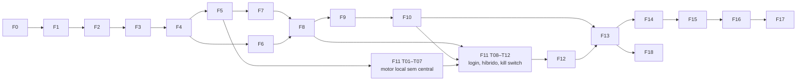

<!-- Gerado por split_plan.py a partir do plano em ficheiro único. Não editar à mão. -->

# Plataforma RAG Multi-Negócio — Plano de Implementação para Agentes

**Versão 1.0 · 2026-11-21**
Este plano substitui o roadmap (secção 7) da *Especificação Técnica v0.1*. As secções 1–6 e 10–11 da especificação continuam a ser a referência de produto, com as correções da Parte A. Onde houver conflito, **este documento prevalece**. A especificação vai no mesmo pacote, em Markdown, e no repositório vive em `docs/spec/especificacao-v0.1.md`; quando um cartão diz "especificação 4.2.1", é essa secção desse ficheiro.

## Como ler este documento

| Quem | O que lê |
|---|---|
| **OLEK** (dono do produto) | Parte A (avaliação e alterações), Parte E (o que te vão pedir), Parte F (trilha de negócio) |
| **Agente de desenvolvimento** | Parte B inteira, sempre. Da Parte C, só as secções que o cartão indica em "Ler antes". Da Parte D, só o cartão da tarefa |
| **Revisor de PR** | Parte B3 (DoD), Parte C5 (invariantes), Parte G5 (checklist de segurança) |

O plano foi escrito para que um agente com pouco contexto consiga executar **uma tarefa de cada vez** sem conhecer o resto. Cada cartão diz que ficheiros criar, que interfaces usar, que testes escrever, como verificar que terminou e quando pedir ajuda ao OLEK.

Existe também uma **versão dividida** (uma pasta com um ficheiro por tarefa), gerada a partir deste documento pelo script `split_plan.py`. No repositório, essa pasta vive em `docs/plan/`.

## Índice

- **Parte A** — Avaliação do plano original e alterações
- **Parte B** — Protocolo do agente
- **Parte C** — Contexto global (C1–C13)
- **Parte D** — Roadmap: 19 fases e cartões de tarefa (F0–F18)
- **Parte E** — Pedidos humanos previstos (HR-01…HR-26)
- **Parte F** — Trilha não técnica (negócio, legal, contas)
- **Parte G** — Templates (cartão, ADR, pedido humano, PR, checklist de segurança)

---

# PARTE A — Avaliação do plano original e alterações

## A1. O que está bem e se mantém

- **Visão dos dois produtos** e a tabela de fontes por produto (web: conhecimento geral + base da empresa; local: + documentos próprios da pasta autorizada). Mantém-se como regra MUST.
- **Princípios**: dados perto do cliente, minimização, uma base com várias implantações, respostas com fontes, secure by default.
- **Pipeline de ingestão** na ordem certa (descoberta → validação → sandbox → conversão → limpeza → chunking → metadados → embeddings → indexação → incremental).
- **Modelo de ameaças STRIDE** e defesas específicas de LLM alinhadas com o OWASP Top 10 for LLM Applications.
- **Interfaces** (`LLMProvider`, `VectorStore`, `BlobStore`, `AuthProvider`) para que passar do MVP gratuito à produção seja configuração e não reescrita.
- **Extensibilidade** (back-office, feature flags, módulos, branding) preparada desde cedo, implementada mais tarde.
- **Avaliação com golden set** e gate no CI.

## A2. Problemas encontrados e correções

Gravidade: 🔴 alta (falha de segurança ou bloqueio) · 🟠 média · 🟡 baixa.

| # | Grav. | Problema no plano original | Correção neste plano |
|---|---|---|---|
| 1 | 🔴 | Fases de 1–4 semanas com 5–8 entregáveis cada. Um agente fraco não as consegue executar sem contexto amplo. | 19 fases e ~140 tarefas de ½–1 dia, com cartões autocontidos (ficheiros, interfaces, passos, testes, DoD). |
| 2 | 🔴 | Testes só como DoD de alto nível; nenhuma estratégia de teste. | Estratégia completa (C10): fakes determinísticos, corpus sintético com canários, suite de contrato partilhada, testes por invariante, red team com "LLM comprometido". |
| 3 | 🔴 | O RLS não se aplica se a API ligar ao Postgres com uma role privilegiada (ex.: `service_role`, que tem BYPASSRLS) ou como dona da tabela sem `FORCE`. O plano original não dizia com que role a API liga. | Roles da aplicação sem BYPASSRLS, `FORCE ROW LEVEL SECURITY`, `set_config('app.tenant_id')` por transação e um teste que falha se alguma tabela não tiver RLS (C7, F7). |
| 4 | 🔴 | O Supabase expõe o schema `public` pela Data API com a chave anónima. | Tabelas no schema `app`, sem grants para `anon`/`authenticated`; todo o acesso passa pela Central API. |
| 5 | 🔴 | App desktop com OIDC + PKCE, mas o Supabase Auth não tem ecrã de login alojado. | Usar o OAuth 2.1 Server do Supabase (beta pública desde nov/2025; confirmar o estado no spike) com página de consentimento no portal. Plano B documentado: fluxo próprio RFC 8252 na Central API. Registo de dispositivos e kill switch independentes do emissor do token. |
| 6 | 🔴 | O índice local exige encriptação em repouso com SQLCipher, mas propõe LanceDB/Qdrant, que não se encriptam com SQLCipher. | Índice local num único ficheiro SQLCipher (metadados + FTS5 + vetores em BLOB), pesquisa vetorial em memória com numpy até ~200 mil chunks; ADR de migração se crescer. |
| 7 | 🟠 | Contradição de IdP: Keycloak (5.2 e compose da Fase 0) vs Supabase Auth (secção 10). | Supabase Auth atrás de `AuthProvider`; Keycloak sai do compose. |
| 8 | 🟠 | Contradição de vector store: Qdrant no compose + pgvector + LanceDB. | pgvector na central; SQLite/SQLCipher no local; Qdrant removido. |
| 9 | 🟠 | "Responde sempre com fontes" vs "conhecimento geral do LLM ✔". | Política por tenant: conhecimento geral **rotulado** (omissão) ou **proibido**. O validador de citações conhece os dois casos. |
| 10 | 🟠 | Meta p95 < 6 s no modo híbrido, impossível na GTX 1660 com modelos 7–8B (prefill de ~3 mil tokens + ~300 tokens gerados fica na ordem dos 10–20 s; estimativa, medir na F5). | Metas por ambiente. No MVP mede-se o tempo até ao primeiro token (TTFT) com streaming; o p95 < 6 s fica para a infraestrutura de produção. |
| 11 | 🟠 | Token com `tenant_id`/`groups` impede revogação imediata e cria dados obsoletos. | O token só prova identidade. Tenant, papel, grupos e produtos são resolvidos no servidor (cache ≤ 60 s). |
| 12 | 🟠 | Sandbox "sem rede" no desktop Windows/macOS não é exequível sem privilégios de administrador. | Central: contentor sem rede (isolamento real). Desktop: subprocesso com limites, bloqueio de rede em Python e parsers que recebem bytes, nunca caminhos. Risco residual documentado em ADR. |
| 13 | 🟠 | Docling + torch dentro de um instalador desktop dá vários GB. | Perfil de parsing **lite** (bibliotecas Python puras + ONNX) no desktop e **full** (Docling) na central. Ambos produzem o mesmo `StructuredDocument` e passam os mesmos testes. |
| 14 | 🟠 | Sem política de licenças. PyMuPDF (AGPL), extract-msg (GPL-3.0), html2text (GPL-3.0) ou rerankers CC-BY-NC tornariam o produto não vendável. | Allowlist de licenças por componente, verificada no CI (C4, F0-T08); modelos só com licença comercial. |
| 15 | 🟠 | Certificate pinning (5.4) é incompatível com Cloudflare Tunnel: o TLS termina na Cloudflare e os certificados rodam. | Pinning adiado com ADR; a Cloudflare entra na lista de subcontratantes. |
| 16 | 🟠 | A Vercel corre as funções por omissão em Washington (`iad1`). Os dados das conversas passariam pelos EUA. | Fixar região UE (ex.: `fra1`) desde o primeiro deploy, com teste. |
| 17 | 🟠 | O Langfuse grava prompts e respostas, o que viola "zero conteúdo em logs" com dados reais. | Langfuse só em dev/evals com dados sintéticos; em produção só métricas. |
| 18 | 🟠 | O Ollama não tem autenticação. | Nunca exposto: só na rede Docker interna, com teste à configuração (INV-24). |
| 19 | 🟡 | App local (Fase 3) antes do repositório central (Fase 4), mas o Produto B precisa de identidade, entitlements, dispositivos, kill switch e repositório central. | Nova ordem: core → gateway → central → back-office → web → motor local → desktop. O motor local só depende do core e do gateway, por isso pode ser antecipado se preferires (ver A4). |
| 20 | 🟡 | Sem fila de ingestão, retenção, exportação ou eliminação de tenant concretas. | Jobs em Postgres (`SKIP LOCKED`), jobs de retenção e exportação, crypto-shredding dos originais. O texto dos chunks fica protegido por RLS + encriptação do disco (documentado). |
| 21 | 🟡 | Perguntas de seguimento ("e no ano passado?") falham sem reescrita da pergunta. | Condensação da pergunta com o histórico (F4-T06). |
| 22 | 🟡 | Streaming e validação de citações não convivem sem desenho. | Stream de tokens + evento final de validação; a UI substitui a resposta se a validação falhar. |
| 23 | 🟡 | O Supabase Free não tem backups descarregáveis (a própria Supabase recomenda exportar com `pg_dump`). | `pg_dump` encriptado diário + teste de restauro mensal (F13-T04). |
| 24 | 🟡 | Os scopes Google `drive.readonly` e `gmail.readonly` são "restritos" (exigem verificação de segurança anual, paga). | Decisão de negócio antes das fases de conectores e email (HR-23). |
| 25 | 🟡 | GitHub Actions em repositório privado: minutos Windows contam 2× e macOS 10×. | Matriz multi-SO só quando muda o motor local/desktop, e à noite. |

**Confirmado e mantido:** a especificação dizia que o Docling lê EML e MSG; a documentação atual do Docling confirma ambos. Como o Docling só entra no perfil *full* (central), no desktop o EML usa a biblioteca padrão do Python e o MSG fica pendente de decisão de licença (HR-04).

## A3. O que foi acrescentado

1. **Protocolo do agente** (Parte B): prompt de arranque, regras, DoD global, regras anti-batota nos testes, formato para pedir coisas ao OLEK sem expor segredos.
2. **Contratos de código exatos** (C6): tipos e interfaces Python que todos os cartões usam.
3. **24 invariantes de segurança numerados** (C5), cada um com testes nomeados `test_invNN_…` e um gate no CI que falha se algum ficar sem teste.
4. **Corpus sintético** de duas empresas fictícias, com canários, documentos maliciosos e ficheiros inválidos, e um golden set ligado a factos exatos (C11).
5. **Esquema de BD com RLS** e tabela de verdade de acessos (C7, C8), com um teste que compara o filtro SQL com a política em Python.
6. **Desenho completo do Produto B**: autenticação da app, registo de dispositivos, licença offline com período de graça, kill switch que apaga credenciais e índice, FileGate (único ponto de leitura de ficheiros) e teste com *audit hooks* do Python que prova que nada fora das pastas consentidas é aberto.
7. **Política de licenças** com verificação automática e perfis de parsing lite/full; empacotamento do motor local com orçamento de tamanho.
8. **Operação**: fila de jobs, retenção, exportação, eliminação de tenant, backups com restauro testado, observabilidade sem conteúdo, red team contínuo, runbooks.
9. **Marcos** (M1–M6) e grafo de dependências.
10. **Planeamento por ondas**: F15–F18 têm cartões resumidos e começam por uma tarefa "refinar a fase", porque vão mudar até lá.

## A4. Nova ordem das fases

| Plano original | Este plano |
|---|---|
| Fase 0 — Fundações | **F0** Fundações do repositório · **F1** Contratos do core e fakes · **F2** Corpus sintético e golden set |
| Fase 1 — Core RAG local | **F3** Ingestão · **F4** Recuperação e geração · **F5** CLI, modelos reais e avaliação (**M1**) |
| Fase 2 — Gateway + Hugging Face | **F6** Inference Gateway (**M2**) |
| Fase 4 — Repositório central + Produto A | **F7** BD central, tenancy e identidade · **F8** Central API · **F9** Back-office e extensibilidade (**M3**) · **F10** Aplicações web (**M4**) |
| Fase 3 — Produto B | **F11** Motor local · **F12** App desktop (**M5**) |
| *(novo)* | **F13** Endurecimento e prontidão para piloto (**M6**) |
| Fase 5 — Piloto | **F14** Piloto real |
| Fases 6, 7, 8 | **F15** Conectores cloud · **F16** Email: pesquisa · **F17** Email: rascunhos |
| Fase 9 | **F18** Plataforma multi-negócio |
| Fase 10 | Backlog |

**Porque esta ordem:** o core valida a qualidade antes de investir em produto; o gateway centraliza custos e políticas; a central traz a peça com mais risco (fuga entre tenants), que deve ser testada o mais cedo possível; o portal web é o caminho mais rápido para uma demo e um piloto; o Produto B reaproveita tudo isto (identidade, dispositivos, pesquisa federada). Se preferires o Produto B primeiro, F11-T01 a T07 podem correr logo a seguir à F5.

**Marcos:**

| Marco | Fim de | O que se consegue mostrar |
|---|---|---|
| M1 | F5 | CLI `rag ingest` / `rag ask` com modelos reais, citações e métricas no golden set |
| M2 | F6 | Gateway na Máquina 1 com quotas, rate limit e fallback |
| M3 | F9 | Plataforma central multi-tenant com back-office (API) e staging |
| M4 | F10 | Portal web do Produto A em staging (demo) |
| M5 | F12 | App desktop do Produto B com instaladores |
| M6 | F13 | Pronto para piloto: gates de segurança, backups, runbooks |

## A5. Decisões tomadas por omissão (podes reverter)

| ID | Decisão | Porquê | Onde muda |
|---|---|---|---|
| D1 | Produto A antes do B | Ver A4 | Ordem das fases |
| D2 | Supabase Auth; desktop via OAuth 2.1 Server do Supabase (plano B: fluxo próprio) | Menos código de segurança escrito por agentes | ADR-0005, ADR-0010 |
| D3 | Python **síncrono** (endpoints FastAPI com `def`) | Mais simples de escrever e testar por agentes fracos; escala suficiente no MVP | ADR-0008 |
| D4 | psycopg 3 + SQL explícito, sem ORM | O contexto de tenant fica visível em cada query | F7-T03 |
| D5 | Migrações SQL próprias, uma só fonte para testes e Supabase | Paridade dev/teste/produção | F7-T01 |
| D6 | Uma implementação `OpenAICompatible` para LLM e embeddings | Cobre Ollama, llama.cpp, vLLM, TGI e HF Endpoints | F5-T02 |
| D7 | Conhecimento geral **rotulado** por omissão | Pedido original: conhecimento geral + da empresa | C6 `TenantPolicy` |
| D8 | Documentos `restricted` nunca vão para a cloud a partir do Produto B (por omissão) | Secure by default | C6 `TenantPolicy.block_cloud_for` |
| D9 | Fila de jobs em Postgres; Redis só para rate limit com várias instâncias | Menos peças no MVP | F7-T07 |
| D10 | Tailwind + shadcn/ui; componentes de chat partilhados em `packages/ui` | Web e desktop com a mesma UI | F10 |
| D11 | macOS distribuído fora da App Store (sem App Sandbox, sem security-scoped bookmarks) | Simplifica o acesso a pastas escolhidas | ADR em F12 |
| D12 | MSG só no perfil full depois de validar licenças; no desktop fica "não suportado" até decisão | Evitar GPL no binário distribuído | HR-04 |

## A6. Riscos principais e mitigação

| Risco | Impacto | Mitigação no plano |
|---|---|---|
| Máquina 1 é ponto único de falha e a GTX 1660 limita a latência e a concorrência | Demos lentas; piloto com poucos utilizadores simultâneos | Streaming e TTFT como métrica (F4-T08, F5-T05); testes de capacidade (F13-T05); interfaces que permitem trocar para HF/cloud por configuração; runbook de falha (F13-T07) |
| OAuth 2.1 Server do Supabase ainda em beta | Login do Produto B bloqueado ou instável | Spike e ADR-0010 (F10-T08); plano B pronto (F8-T12) |
| FTS5 indisponível no SQLCipher de algum SO | Pesquisa lexical local falha | Fallback BM25 em memória (F5-T01), testado na matriz multi-SO (F11-T02) |
| Tamanho do instalador do Produto B | Instalação pesada, atualizações lentas | Perfil lite sem torch/Docling, modelos descarregados à parte com hash (F11-T12), orçamento de tamanho no CI |
| Qualidade variável do trabalho de agentes fracos | Bugs subtis, sobretudo de segurança | Cartões pequenos, contratos congelados, testes por invariante, regras anti-batota (B4), gates por fase, checklist de PR (G5) |
| Prompt injection evolui mais depressa que as regras | Respostas manipuladas | Defesas que não dependem do modelo (ACL antes do LLM, sem ferramentas, filtro de saída, validação de citações) provadas com um LLM "obediente" (F13-T01) |
| Planos gratuitos mudam de termos (Vercel Hobby não comercial, Supabase Free pausa projetos) | Interrupção do serviço ou violação de termos | Confirmar antes de cada transição e registar em ADR; passar a planos pagos antes de clientes pagantes (HR-13) |

---
